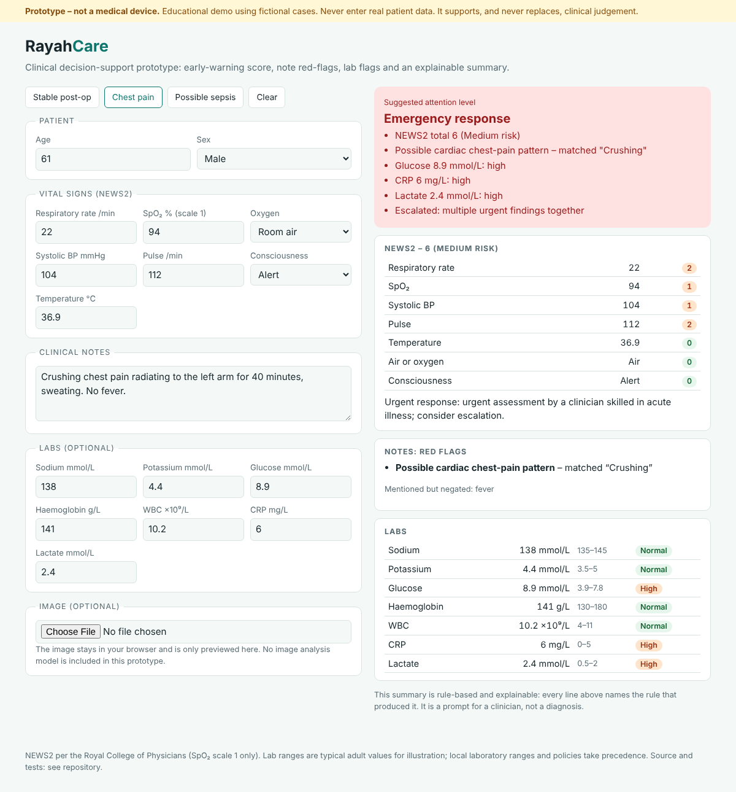

# RayahCare

**A web-based clinical decision-support prototype that turns patient data into an explainable summary.**



> **Prototype, not a medical device.** Fictional cases only. Never enter real patient data. It is a
> teaching project that supports, and never replaces, clinical judgement.

Open `index.html` in a browser (or host it free with GitHub Pages). It runs entirely client-side,
with no server and no data leaving your computer.

## What it does

1. **NEWS2 early-warning score** from respiratory rate, SpO2 (scale 1), oxygen use, systolic BP,
   pulse, consciousness and temperature, using the Royal College of Physicians scoring table, with
   the recommended clinical response and a warning when vitals are missing.
2. **Red-flag extraction from free-text notes** (cardiac, stroke, allergic reaction, respiratory
   distress, bleeding, collapse, self-harm, fever) with **negation handling**: "no chest pain" is
   not flagged, "crushing chest pain radiating to the left arm" is.
3. **Lab flags** against typical adult reference ranges (sex-specific haemoglobin), with critical
   values highlighted.
4. **One attention level** (routine, increased monitoring, urgent review, emergency response)
   combined from the three sources, with **every reason listed**, so a clinician can see exactly why.
5. **Image attachment** is previewed locally. No image-analysis model is included, so nothing is
   inferred from images.

## Why rules and not a black box

Decision support in healthcare has to be explainable and auditable. Each line of the summary names
the rule that produced it, and the logic is small enough to read in one sitting. The structure is
ready for a trained model to be added later as one more input to the same explainable summary.

## Tests

```
node test_rayahcare.js
```

10 tests cover the NEWS2 boundary values from the RCP chart, a worked septic example (13, high),
missing-vital handling, negation, sex-specific lab ranges and the three example cases.

## Limits

NEWS2 SpO2 scale 2 (for patients with chronic hypercapnic respiratory failure) is not implemented.
Reference ranges are typical adult values and local laboratory ranges take precedence. Keyword rules
miss misspellings and unusual phrasing. No paediatric scoring.
This is my own rebuild of a project idea from my training.
