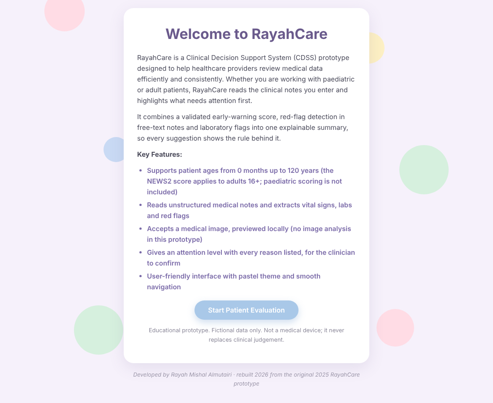
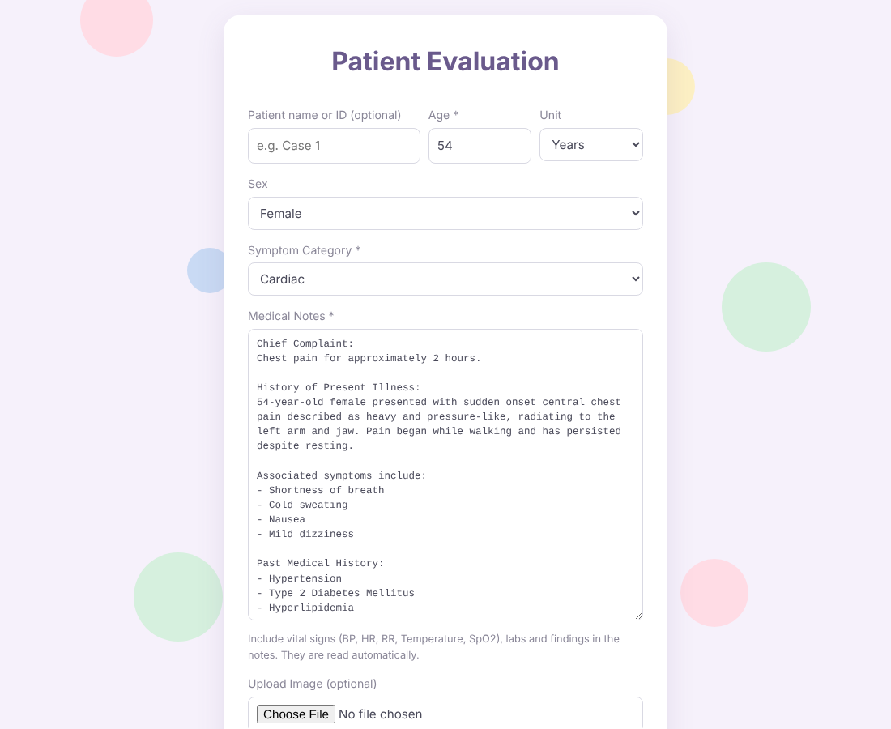
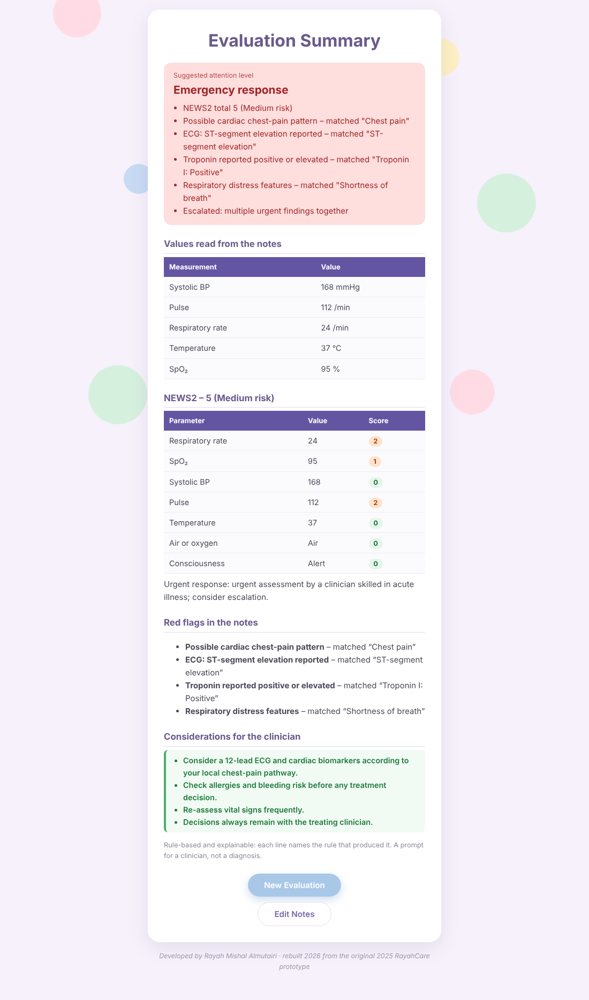

# RayahCare

**A web-based clinical decision-support prototype that reads medical notes and turns them into an explainable summary.**

| Welcome | Evaluation form | Evaluation summary |
|---|---|---|
|  |  |  |

> **Prototype, not a medical device.** Fictional cases only. Never enter real patient data. It is a
> teaching project that supports, and never replaces, clinical judgement.

Open `index.html` in a browser (or host it free with GitHub Pages). It runs entirely client-side,
with no server and no data leaving your computer.

## How it works

1. **Welcome** screen, then **Start Patient Evaluation**.
2. Enter the patient's age (0 months to 120 years), sex, category and the **unstructured medical notes**.
   A medical image can be attached (previewed locally only).
3. **Analyze** returns the evaluation summary: one attention level, with every reason listed.

## What it does

- **Reads vital signs from the notes**: blood pressure, pulse, respiratory rate, temperature, SpO2,
  oxygen use and consciousness (ACVPU), then computes the **NEWS2 early-warning score** (Royal College
  of Physicians table, SpO2 scale 1, adults 16+). Missing vitals are reported, never silently scored as 0.
- **Red-flag extraction** (cardiac, ECG changes, troponin, stroke, allergic reaction, respiratory
  distress, bleeding, mental health, fever) with **negation handling**: "no chest pain" is not flagged.
- **Lab flags** against typical adult reference ranges (sex-specific haemoglobin).
- **Escalation rule**: several urgent findings together, or an urgent finding with NEWS2 of 5 or more,
  raise the level to *Emergency response*.
- **Considerations for the clinician**, tailored to the findings. Decisions stay with the clinician.
- Patients under 16 are **not** scored with NEWS2 (it is validated for adults); the app says so.

## Why rules and not a black box

Decision support in healthcare has to be explainable and auditable. Each line of the summary names
the rule that produced it, and the logic is small enough to read in one sitting. There is no AI model
and no image analysis in this prototype.

## Tests

```
node test_rayahcare.js
```

13 tests cover the NEWS2 boundary values from the RCP chart, a worked septic example (13, high),
missing-vital handling, reading values from free text, negation, sex-specific lab ranges, adult-only
gating, and the chest-pain and stable demo cases.

## Limits

NEWS2 SpO2 scale 2 (chronic hypercapnic respiratory failure) is not implemented. Reference ranges are
typical adult values; local laboratory ranges take precedence. Keyword rules miss misspellings and
unusual phrasing. No paediatric scoring.

This is a rebuild (2026) of my original 2025 RayahCare prototype, with the same interface.
